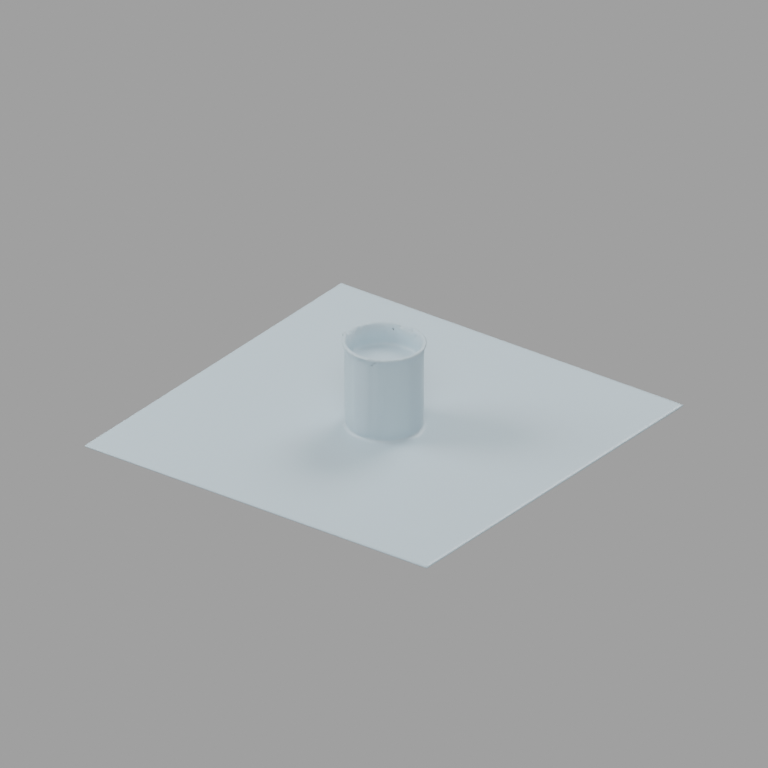
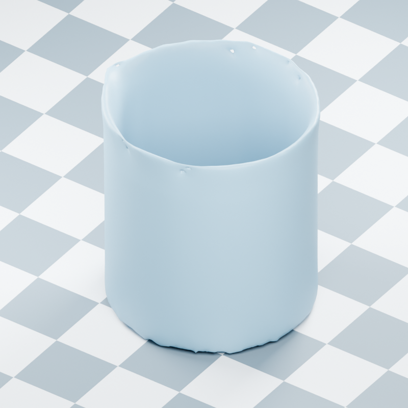
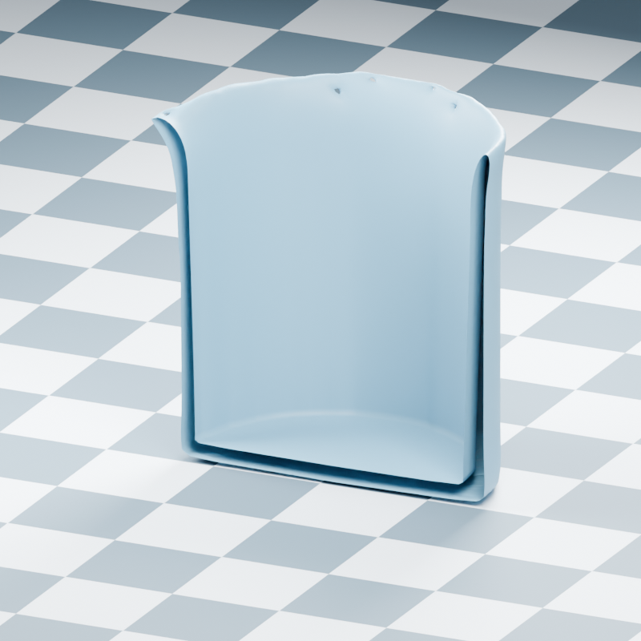
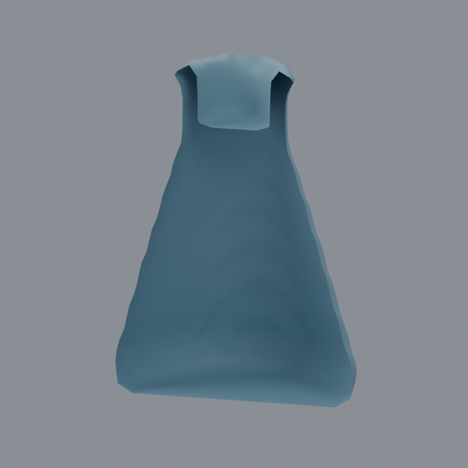
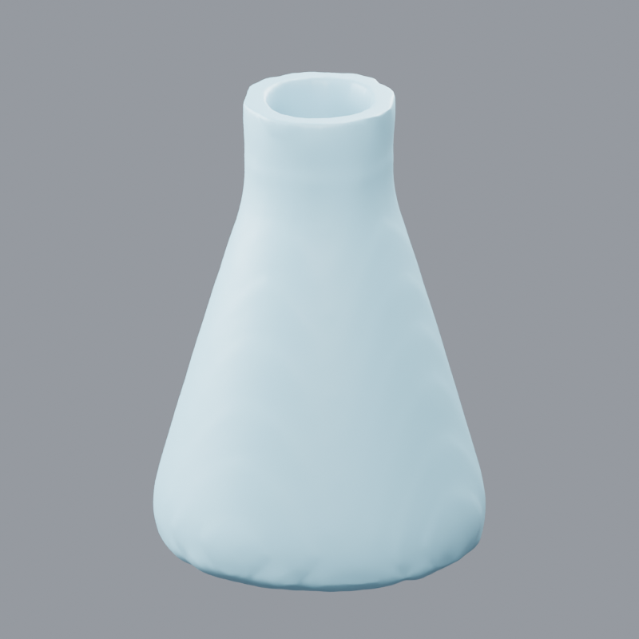
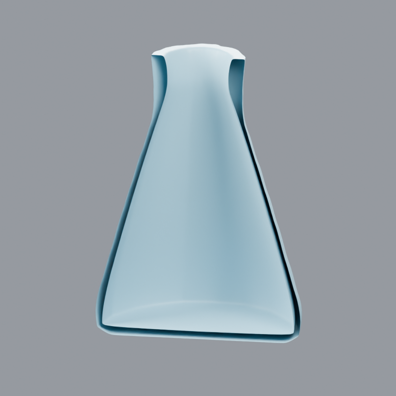

# 小作业2 建模清单与对比

依据 Lecture03 第14页“建模清单：可仅限对象，可不涉及场景”，本次选取参与实验交互的器皿作为对象建模范围。实验桌、地面属于基础场景，保留程序几何，不计入混元生成结果；独立托盘已从正式场景移除。此为项目对范围的划分，并非老师另行批准。

## 对象清单

| 对象 | 几何来源 | 优化结果 | PC 使用 |
| --- | --- | --- | --- |
| 锥形瓶 ReactionVessel | Hunyuan3D-2.1 单图生成 | Blender 修复空腔、瓶口、表面 | 一只反应容器 |
| 过氧化氢烧杯 Reagent_Peroxide | Hunyuan3D-2.1 烧杯网格 | Blender 空心烧杯 | 青色试剂实例 |
| 洗洁精烧杯 Reagent_Soap | 复用同一烧杯网格 | 同上 | 橙色试剂实例 |
| 色素烧杯 Reagent_Color | 复用同一烧杯网格 | 同上 | 红色试剂实例 |
| 催化液烧杯 Reagent_Catalyst | 复用同一烧杯网格 | 同上 | 浅色试剂实例 |

清单共5个场景实例、2种独立几何。模型、标签和试剂状态分别处理；没有把复用实例描述为额外独立推理。旧清单中的桌子改归场景设施，托盘取消，历史测试场景及备份不属于本次运行场景。

## 自动生成与软件优化对比

| 检查项 | 原始生成结果 | Blender 优化结果 |
| --- | --- | --- |
| 烧杯 | 大体杯身存在，但有附带底板、粗糙表面和假水面隔板，内腔过浅 | 去底板和隔板，补下部内壁，形成深约9.55cm的开放内腔 |
| 锥形瓶 | 外形基本正确；假水面位于总高约82%，瓶口不平 | 去假底、沿锥形外壁补内壁，修整瓶口并平滑表面 |
| 外观与尺寸 | 未生成正式纹理，原始坐标未校准 | 添加玻璃材质，保存可调整尺寸并导出FBX |
| 几何检查 | 外形接近不代表能装液体 | 剖面与向下射线确认空腔；边界边、非流形边均为0 |

烧杯原始结果与修复结果：

锥形瓶隔板修复前后：

原始与修复图使用诊断视角，尺度、材质和相机可能不同；不据图片计算精确尺寸或性能提升。修复是质量与可用性的改善，并未宣称降低所有模型面数。准确参数见21/24号描述及结果包中的JSON报告。

## 提交文件

Docs 目录包含老师要求的21号算法描述、22号算法输入ZIP、23号算法结果ZIP、24号软件描述、25号软件结果ZIP。总工程包命名为 `24371102+赵开明-00-第2次小作业.zip`。PPT第16页注明提交截止时间为2026年10月29日24:00；本地打包不代表已经上传课程云盘。
